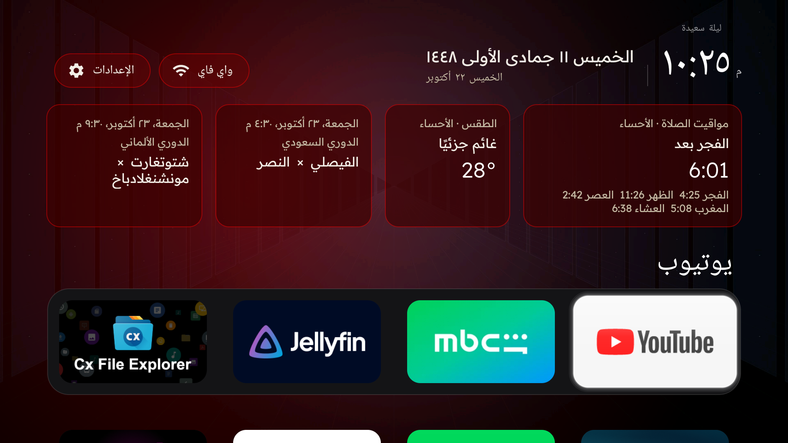
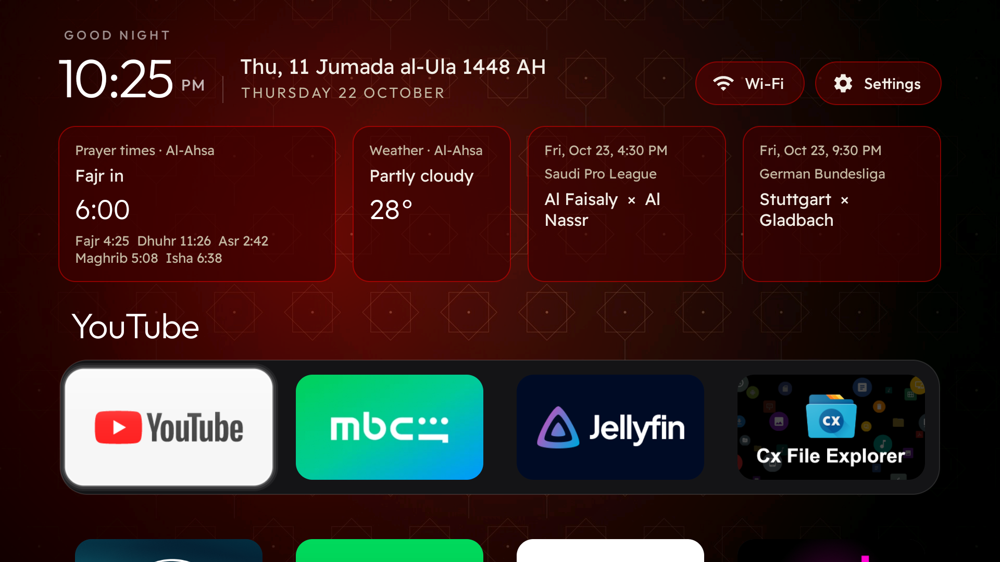
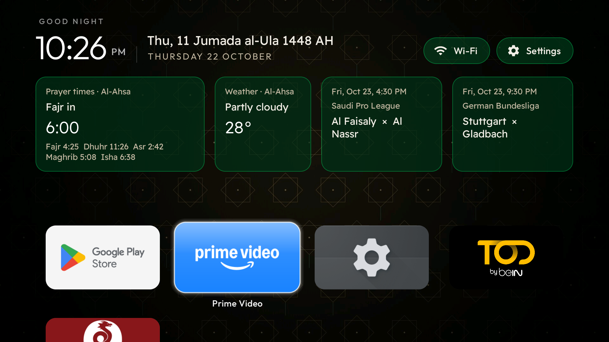
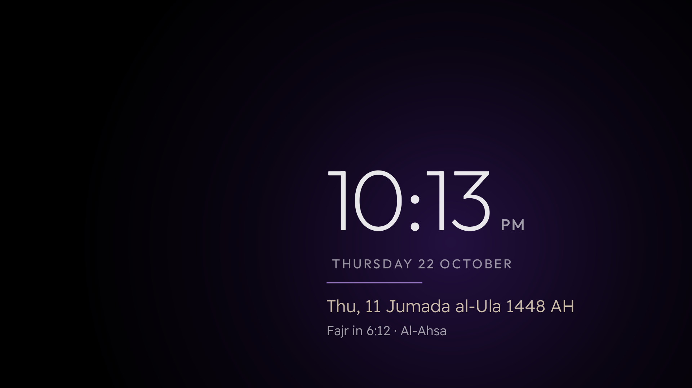

<div dir="rtl">

<div align="center">

# هوم لاب لانشر (HomeLab Launcher)

**شاشة رئيسية عربية لأجهزة Google TV: مواقيت الصلاة، التاريخ الهجري، الطقس، ومباريات دوريك، بدون إعلانات.**

جُرّبت على Chromecast with Google TV 4K (أندرويد 14). بدون روت، وبدون حساب، وكل خطوة لها رجوع.

[](https://github.com/techdev-lab/homelab-launcher/actions/workflows/ci.yml)
[](LICENSE)


[English](README.md) · [دليل التثبيت](docs/INSTALL.md) · [الإعدادات](docs/CONFIG.md) · [قصة المشروع](docs/JOURNEY.ar.md) · [أوامر جاهزة للذكاء الاصطناعي](docs/AI_ASSISTANT_PROMPTS.ar.md) · [الأمان](SECURITY.md) · [المساهمة](CONTRIBUTING.md)



</div>

---

## ليش هذا المشروع؟

الشاشة الأصلية في Google TV مليانة إعلانات واقتراحات، وتكلم البيت العربي بالإنجليزي، وما تعرف شي عن الصلاة ولا عن الدوريات اللي نتابعها. هذا اللانشر يحل محلها بشاشة هادئة بتصميم زجاجي تعرض **المهم بنظرة وحدة**: تطبيقاتك، والصلاة الجاية، والطقس، ومباراة دوريك الجاية.

موجّه للبيوت المسلمة والعربية، لكنه مو مربوط بدولة: تختار مدينتك للصلاة، ودورياتك لبطاقات الكورة. المصري يحط دوري أبطال أفريقيا، والإماراتي دوري أبطال آسيا وكأس الخليج، والسعودي دوري روشن، وهكذا.

## وش فيه؟

| | |
|---|---|
| **عربي وإنجليزي بالكامل** | يتبع لغة التلفزيون. الجهاز عربي = الشاشة كلها عربي من اليمين لليسار، حتى أسماء التطبيقات (يوتيوب، شاهد، جيليفين…) والدوريات و114 فريقاً. الجهاز إنجليزي = كلها إنجليزي. |
| **مواقيت الصلاة بدون إنترنت** | بطريقة أم القرى، تنحسب على الجهاز من إحداثيات مدينتك. بدون تحديد موقع: تكتب المدينة في الإعدادات. فرقها عن مصدر مستقل أقل من دقيقتين. |
| **التاريخ الهجري** | تقويم أم القرى، جنب الميلادي. |
| **بطاقات الكورة** | بطاقة لكل مجموعة دوريات جنب بعض، مثلاً: الدوري السعودي، والدوريات الأوروبية الكبرى. المباشر أولاً، وإلا أقرب مباراة خلال 7 أيام. |
| **الطقس** | لنفس المدينة (Open-Meteo، مجاني وبدون مفتاح). |
| **شريط تطبيقاتك** | أربع تطبيقات تختارها فوق (يوتيوب، نتفليكس، شاهد، جيليفين، برنامج IPTV، أي شي)، والباقي تحت في شبكة. |
| **زر يوتيوب في الريموت** | يبقى شغّال بعد ما نوقف اللانشر الأصلي. |
| **شاشة توقف** | ساعة رفيعة تنساب على الشاشة، معها الهجري والصلاة الجاية ووهج يتغيّر لونه بهدوء (تحمي الشاشة من الحرق). |
| **علامة الـVPN** | لو حطيت تطبيق الـVPN (مثل WireGuard) في الإعدادات، يطلع جنب كلمة واي فاي **VPN بالأخضر** وقت ما يكون شغّال، وبالأحمر لو انقطع. |
| **نسختين** | `online` (كورة وطقس) و`offline` (بدون صلاحية إنترنت أبداً). |
| **خفيف وخاص** | حوالي 500 كيلوبايت مع الخطوط. لا تتبع ولا حسابات ولا إعلانات. نسخة offline ما تقدر توصل للإنترنت أصلاً. |

| بالإنجليزي | شبكة التطبيقات | شاشة التوقف |
|---|---|---|
|  |  |  |

## البداية السريعة

تحتاج كمبيوتر (ويندوز أو ماك أو لينكس) على نفس الواي فاي حق التلفزيون، والريموت، وحوالي نص ساعة.

1. **اقرأ [دليل التثبيت](docs/INSTALL.md) مرة كاملة قبل ما تبدأ.** فيه الترتيب الصحيح، والفخ الوحيد اللي ممكن يدخل الجهاز في إعادة تشغيل متكررة.
2. **اكتب كلمة سر الواي فاي على ورقة.**
3. نزّل أداة [Android platform-tools](https://developer.android.com/tools/releases/platform-tools) الرسمية (فيها `adb`).
4. في التلفزيون: حدّث النظام، فعّل Developer options (اضغط 7 مرات على Android TV OS build في About)، وشغّل **Wireless debugging**، ثم:
   ```bash
   adb pair <IP>:<منفذ-الإقران> <الكود>
   adb connect <IP>:<المنفذ>
   ```
5. ثبّت التطبيق كتطبيق عادي (الشاشة الأصلية تبقى). ما فيه إصدار جاهز للتنزيل بعد، فابنِ الملف أول من قسم «بناء التطبيق» تحت:
   ```bash
   adb install tvhome-online.apk
   ```
6. انسخ `config/config.example.json` أو مدينة من `config/examples/`، عدّل المدينة والدوريات والتطبيقات، وادفعه:
   ```bash
   adb push config.json /sdcard/Android/data/com.gathin.tvhome/files/config.json
   ```
7. خلّه الشاشة الرئيسية بالسكربت `scripts/Set-TvhomeAsHome.ps1` (يجرب أول بدون تغيير)، ثم فعّل زر يوتيوب وشاشة التوقف. التفاصيل في [دليل التثبيت](docs/INSTALL.md).

> [!WARNING]
> **لا توقف اللانشر الأصلي `launcherx` وحزمة `setupwraith` لسه شغّالة.** Google TV ساعتها يخلي معالج الإعداد هو الشاشة الرئيسية، والجهاز ممكن يعلق في إعادة تشغيل. السكربت يسويها بالترتيب الصحيح. ولو صارت، الحل: **اضغط مطوّلاً الزر اللي ورا الكروم كاست لين اللمبة تصير صفراء ثم بيضاء** (factory reset). كل التفاصيل في [قسم الإنقاذ](docs/INSTALL.md#rescue).

## أسماء الدوريات اللي تشتغل

`ksa.1` دوري روشن · `ksa.kings.cup` كأس الملك · `afc.champions` أبطال آسيا · `caf.champions` أبطال أفريقيا · `caf.confed` الكونفدرالية · `global.gulf_cup` كأس الخليج · `uefa.champions` أبطال أوروبا · `eng.1` الإنجليزي · `esp.1` الإسباني · `ita.1` الإيطالي · `ger.1` الألماني · `fra.1` الفرنسي · `fifa.worldq.afc` و`fifa.worldq.caf` تصفيات كأس العالم.

**صراحة:** مصدر البيانات (ESPN) ما فيه الدوري المصري ولا الإماراتي ولا القطري ولا المغربي (جربناها كلها). لو تعرف مصدر مجاني ثاني، ساهم معنا.

## مواقيت الصلاة

الحساب بطريقة **أم القرى** فقط حالياً. في الدول اللي عندها طريقة رسمية ثانية (مثل مصر) ممكن يطلع فرق دقائق. خيار `prayer_method` في خطة التطوير.

## الصلاحيات والخصوصية

| الصلاحية أو المكوّن | النسخة | وش تسوي |
|---|---|---|
| `INTERNET` | online فقط | الكورة (مصدر ESPN العام) والطقس (Open-Meteo) وخلاصات RSS اللي تضبطها. HTTPS فقط، مهلة 8 ثواني، حد 512 كيلوبايت للرد، وما تُتبع التحويلات. |
| `ACCESS_NETWORK_STATE` و`ACCESS_WIFI_STATE` | النسختين | شريحة الواي فاي. |
| `ACCESS_FINE_LOCATION` | النسختين | أندرويد 10 وما فوق ما يخلي التطبيق يقرأ اسم شبكة الواي فاي إلا بها. التطبيق ما يستدعي أي واجهة موقع؛ المدينة تكتبها في الإعدادات. |
| خدمات إمكانية الوصول (`HomeKeyService` و`InputKeyService`) | النسختين، اختيارية | تشغّل زرّي Home وInput في الريموت بعد إيقاف اللانشر الأصلي. ترى ضغطات الأزرار فقط، مو محتوى الشاشة، وتبقى مطفية لين تفعّلها. |
| شاشة التوقف (`ClockDream`) | النسختين | تختارها من الإعدادات. |

بدون تتبع ولا حسابات ولا تقارير أعطال ولا إعدادات عن بُعد. كل التفاصيل في [SECURITY.md](SECURITY.md).

## بناء التطبيق

ما فيه إصدار جاهز للتنزيل بعد، فتبنيه بنفسك. تحتاج JDK 17 وAndroid SDK (المنصة 34):

```bash
cd launcher
./gradlew testOnlineReleaseUnitTest assembleOnlineRelease
```

## تستخدم مساعد ذكاء اصطناعي؟

في [AI_ASSISTANT_PROMPTS.ar.md](docs/AI_ASSISTANT_PROMPTS.ar.md) أوامر جاهزة تنسخها وتلصقها في أي مساعد برمجي (OpenCode أو Codex أو ChatGPT أو غيرها)، فيساعدك خطوة بخطوة مع قواعد الأمان.

## المساهمة والدعم

- **مشكلة؟** افتح بلاغاً من نموذج «Bug report». يسألك عن إصدار التطبيق والنسخة والجهاز، ويذكّرك تشيل عناوين IP والمفاتيح.
- **تبي تساهم؟** [CONTRIBUTING.md](CONTRIBUTING.md) فيه أنفع المساهمات: أسماء فرق عربية لدوريات أكثر، ومصدر كورة مجاني للدوريات العربية، وخيار `prayer_method`، والتجربة على أجهزة ثانية.
- **ثغرة أمنية؟** اتبع [SECURITY.md](SECURITY.md) وما تفتح بلاغاً عاماً.

## الشكر والرخصة

المشروع مبني على لانشر `tvhome` من مشروع [Gathin23/cleanyourtv](https://github.com/Gathin23/cleanyourtv) (رخصة MIT)، ولهذا اسم الحزمة `com.gathin.tvhome`. الخطوط: Outfit وReadex Pro (رخصة SIL OFL 1.1). البيانات: ESPN وOpen-Meteo. التفاصيل في [NOTICE.md](NOTICE.md).

رخصة MIT، شوف [LICENSE](LICENSE).

</div>
