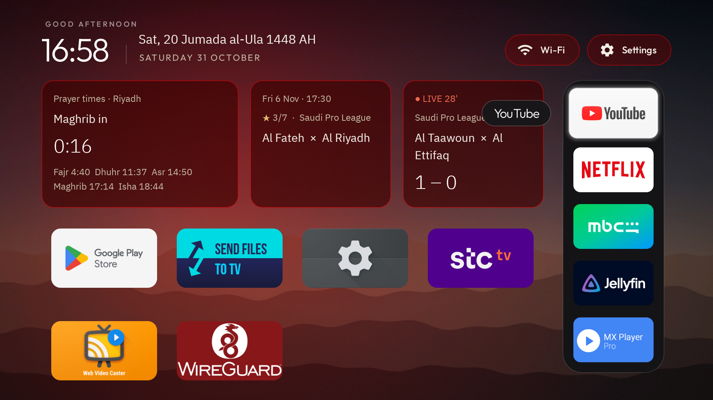
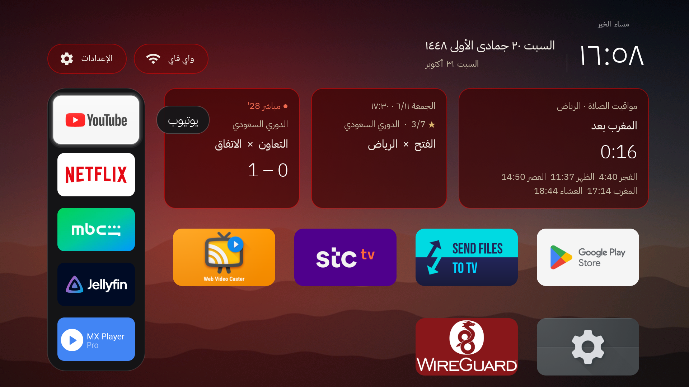

<div align="center">

# HomeLab Launcher · هوم لاب لانشر

**An Arabic-first, privacy-friendly home screen for Google TV, with prayer times, the Hijri date and your football leagues.**

**شاشة رئيسية عربية لأجهزة Google TV: مواقيت الصلاة، التاريخ الهجري، الطقس، ومباريات دوريك، بدون إعلانات.**

[](https://github.com/techdev-lab/homelab-launcher/actions/workflows/ci.yml)
[](https://github.com/techdev-lab/homelab-launcher/releases/latest)
[](LICENSE)


### [English](#english) · [العربية](#العربية)

**[⬇ Download the APK](https://github.com/techdev-lab/homelab-launcher/releases/latest)** · [Install](docs/INSTALL.md) · [Configuration](docs/CONFIG.md) · [Security](SECURITY.md) · [Contributing](CONTRIBUTING.md)

<div dir="rtl">

**[⬇ نزّل ملف APK](https://github.com/techdev-lab/homelab-launcher/releases/latest)** · [التثبيت](docs/INSTALL.ar.md) · [الإعدادات](docs/CONFIG.ar.md) · [الأمان](SECURITY.ar.md) · [المساهمة](CONTRIBUTING.ar.md)

</div>


</div>

---

## English

Built and tested on a Chromecast with Google TV 4K (Android 14). No root. No account. Fully reversible.

[How it was built](docs/JOURNEY.md) · [Use it with an AI assistant](docs/AI_ASSISTANT_PROMPTS.md)

### Why

The stock Google TV home screen is a wall of ads and recommendations, it speaks English to an Arabic household, and it knows nothing about prayer times or the leagues people here actually follow. HomeLab Launcher replaces it with a calm, glass-style home screen that shows **what matters at a glance** and gets out of the way: your apps, the next prayer, the weather, and the next match of your league.

It is written for Muslim and Arabic-speaking households first, but it is not tied to one country: you choose the city for prayer times and the leagues for the football cards.

**One app, three looks.** The same APK carries three wallpaper sets, picked with the remote in *Launcher settings > Wallpapers*, plus six plain colours:

| Look | For | Wallpapers |
|---|---|---|
| **HomeLab** | Home-lab and tech fans | Server racks, a cluster constellation, a terminal, circuits, a data-centre aisle |
| **Serene** | Any home: your parents' TV, a guest room, a waiting room | Ten calm scenes: dusk, misty ridges, still water, dunes, night stars, aurora, sea at dawn... nothing personal |
| **Kids** | A children's TV | A rocket in space, under the sea, a rainbow castle, friendly dinosaurs, balloons, a night garden |
| **Plain colour** | Anyone who wants no picture | Black, navy, teal, forest, burgundy or graphite |

A fresh install starts on **Serene**. Got a Google TV for the children? Pick **Kids**, switch off the football cards, and it is ready.

### What's new in 3.0

The biggest release since the fork. Every new option defaults to the 2.9 look, so an upgrade changes nothing until you pick.

- **Ramadan and prayer:** in Ramadan a card counts down to the **iftar** and to the end of **suhoor**; for a few minutes after each prayer time the prayer card says it is time (no sound); and the **Hijri date** can be moved by up to two days for countries that follow moon sighting.
- **A dock at the side:** put your favourite apps in a column at the end of the reading side, on the **right** on the English screen and on the **left** on the Arabic one, with the other apps beside it. The bottom row of 2.9 is still the default.
- **More looks, all on the TV:** floating-glass or flat dock, soft or normal corners, a glass clock, **Arabic-Indic digits** on either language, and how dark the wallpaper veil is.
- **Hide apps** from the grid, **ignore a remote button** pressed by accident, and matches and weather that come back soon after a start with no network.
- **Arabic for everything on GitHub:** the install guide, configuration guide, security notes, changelog and release notes now come in Arabic too, and so does the store listing.

### 2.9

- **Prayer methods:** 14 methods and Hanafi Asr, picked on the TV; and the **Egyptian, UAE, Qatari and Moroccan leagues** (next kick-off).
- **Your clubs stand out:** a gold star on every match of your favourite clubs, and each club's next two matches, so Al Hilal's AFC Champions League Elite game shows next to the league one.
- **Text size** on the TV: Small, Medium or Large (5, 4 or 3 cards; the rest take turns in the last place).
- A short kick-off line that no longer gets cut or reversed in Arabic, and a new font, **IBM Plex Sans Arabic**.
- Module cards and Move mode, which never worked with the remote, are gone.

### 2.8

- **Everything on the TV, no computer needed** (hold OK on the Settings button > *Launcher settings*): the language (TV language, Arabic or English), the wallpapers (HomeLab, Serene, **Kids**, or a plain colour), **which cards show** (prayer times, weather, football, your clubs: each one on or off), and the **motion** (calm, lively or off).
- **The cards answer the remote:** from the apps press Up to reach them. OK on the clubs card jumps to the next club; OK on the others opens the settings.
- **A ready APK to download** from [Releases](https://github.com/techdev-lab/homelab-launcher/releases/latest) (2.7), and **favourite clubs** (2.6): up to 10 clubs, each one's next or live match in any competition.

Full history: [CHANGELOG.md](CHANGELOG.md).

### Download

| File | What it is |
|---|---|
| `HomeLab-Launcher-<version>.apk` | **The one most people want.** Everything: prayer times, Hijri date, weather, football cards, favourite clubs, all three wallpaper sets. |
| `HomeLab-Launcher-<version>-offline.apk` | The same without any network access (no weather or football). For a TV that must stay offline. |
| `SHA256SUMS.txt` | Checksums, to confirm the download is intact. |

Install it like any sideloaded app: `adb install HomeLab-Launcher-<version>.apk`, or copy it to the TV with an app such as *Send files to TV* or *Downloader* and open it there. It installs **next to** the stock home screen; making it the Home screen is a separate, reversible step ([INSTALL.md](docs/INSTALL.md)). Every release is built and signed by GitHub Actions from the tagged source ([how](docs/RELEASING.md)), so you do not need to trust a file sent by a person or an AI assistant.

**What works straight after installing, and what needs a computer once.** Google TV keeps three things for its own apps, so they take one step with a computer and `adb` (all in [INSTALL.md](docs/INSTALL.md), and all reversible):

| Feature | After installing the APK | How |
|---|---|---|
| Home screen with clock, Hijri date, prayer times, weather, football, clubs, wallpapers and all settings | Works: open *HomeLab Launcher* from your apps | Nothing to do |
| Your city for prayer times and weather | Needs a config file | Copy an example from `config/examples`, push it once ([CONFIG.md](docs/CONFIG.md)) |
| Open it with the Home button (replace Google's home screen) | Needs a computer once | `scripts/Set-TvhomeAsHome.ps1` ([INSTALL.md](docs/INSTALL.md) step 5) |
| YouTube button on the remote | Needs a computer once | One `adb` command ([INSTALL.md](docs/INSTALL.md) step 6) |
| Screensaver (gliding clock with the Hijri date and next prayer) | Needs a computer once | One `adb` command: Google TV's menu hides other screensavers (step 6) |

### What you get

| | |
|---|---|
| **Arabic and English, end to end** | Follows the TV's language, or its own: pick it in *Launcher settings*. In Arabic the whole screen is Arabic, right to left, including app names, league names and 156 team names, and the screensaver follows the same language. In English it is fully English. |
| **Prayer times, offline** | 14 calculation methods (Umm al-Qura by default, Egyptian, Gulf, Dubai, Qatar, Kuwait, Jordan, Morocco, Algeria, Tunisia, Turkey, Muslim World League, ISNA, Karachi) and standard or Hanafi Asr, picked on the TV. Computed on the TV from the coordinates you set: no network and no location lookup. Every method is checked against api.aladhan.com to within 2 minutes; `prayer_adjust` shifts a time by a few minutes if your printed calendar differs. |
| **Hijri date** | Umm al-Qura calendar from the platform's ICU, next to the Gregorian date, with an adjustment of up to two days for countries that follow moon sighting. |
| **Ramadan** | In Ramadan only: a card with the time left to the iftar (Fajr to Maghrib) or to the end of suhoor, the day's two times and the day of Ramadan. A visual alert at each prayer time, without sound. |
| **Football cards** | One card per league group, side by side, e.g. the Saudi Pro League and "the big European leagues". A live match first, otherwise the next kick-off within 7 days. The **Egyptian, UAE, Qatari and Moroccan leagues** work too (next kick-off, no live score). Matches of your favourite clubs carry a gold star. |
| **Wallpapers** | Three built-in sets, **HomeLab**, **Serene** and **Kids**, changing every few minutes, or a plain colour; picked on the TV. Your own pictures still work through the config. |
| **Settings on the TV** | Hold OK on the Settings button: language, apps per row, wallpapers and their dim, which cards show, text size, dock position, dock and clock look, digits, prayer method and Asr, prayer alert, Hijri date, favourite clubs, hidden apps, motion. No computer needed. |
| **Favourite clubs** | Pick up to 10 clubs with the remote (Al Hilal, Al Nassr, Man City...). One card shows each club's live or next two matches in any competition, league, cup or continental, one every 5 seconds, and every match of your clubs gets a gold star. |
| **Weather** | Current conditions for the same city (Open-Meteo, free, no key). |
| **Your dock** | The apps of your choice (YouTube, Netflix, Shahid, Jellyfin, an IPTV player, anything) in a row at the bottom or in a column at the side, the rest in a grid. |
| **Remote buttons** | The YouTube button on the Chromecast remote keeps working after the stock launcher is gone. |
| **Screensaver** | A thin clock that glides around the screen with the Hijri date, the next prayer and a slow colour glow (no burn-in). |
| **VPN indicator** | Set your VPN app (e.g. WireGuard) and the Wi-Fi pill shows a green "VPN" capsule while the tunnel is up, red when it dropped. |
| **Two builds** | `online` (football, weather) and `offline` (no INTERNET permission at all). |
| **Small and private** | About 4 MB with fonts and 22 wallpapers. No analytics, no accounts, no ads. The offline build cannot reach the network. |

| English | Arabic | App grid |
|---|---|---|
|  |  |  |

| Side dock, English (right) | Side dock, Arabic (left) |
|---|---|
|  |  |

### Quick start

You need a Windows, macOS or Linux computer on the same Wi-Fi as the TV, and about 30 minutes.

1. **Read [docs/INSTALL.md](docs/INSTALL.md) once, end to end.** It has the exact order and the one trap that can put the TV in a boot loop.
2. Install the official [Android platform-tools](https://developer.android.com/tools/releases/platform-tools) (adb).
3. On the TV: update the system, enable Developer options and **Wireless debugging**, then pair:
   ```bash
   adb pair <TV-IP>:<PAIR-PORT> <CODE>
   adb connect <TV-IP>:<PORT>
   ```
4. [Download the APK](https://github.com/techdev-lab/homelab-launcher/releases/latest) (or [build it](#build)) and install it as a normal app, the stock home stays:
   ```bash
   adb install HomeLab-Launcher-<version>.apk
   ```
5. Copy `config/config.example.json`, set your city and leagues ([docs/CONFIG.md](docs/CONFIG.md)), push it:
   ```bash
   adb push config.json /sdcard/Android/data/com.gathin.tvhome/files/config.json
   ```
6. Make it the Home screen with `scripts/Set-TvhomeAsHome.ps1` (dry run first). Then turn on the YouTube button and the screensaver. See [INSTALL.md](docs/INSTALL.md).

> [!WARNING]
> **Never disable the stock launcher (`launcherx`) while `setupwraith` is still enabled.** Google TV then falls back to its setup wizard as the Home screen and can loop on boot. The script does it in the safe order; if you do it by hand, follow [INSTALL.md](docs/INSTALL.md) exactly. Rescue, if it happens: [factory reset with the button on the back](docs/INSTALL.md#rescue).

### Build

JDK 17 and the Android SDK (platform 34, build-tools 34) are needed.

```bash
cd launcher
./gradlew testOnlineReleaseUnitTest assembleOnlineRelease   # football + weather
./gradlew assembleOfflineRelease                             # no network at all
```

The APKs land in `launcher/app/build/outputs/apk/<flavor>/release/`. They are signed with your local debug key, which is fine for sideloading. Your own build cannot update a Release APK in place (different key): uninstall first, or keep to one source. Releases: [docs/RELEASING.md](docs/RELEASING.md).

### Repository layout

```
launcher/           Android app (Java), tests in app/src/test
config/             config.example.json and ready examples for a few cities
scripts/            PowerShell helpers: inventory, make-Home, one-shot kit, with a fake-TV test suite
wallpapers/         generated wallpapers built into the APK: homelab/ (6), serene/ (10), kids/ (6), with their generators
docs/               install guide, config reference, design notes, the build story, AI prompts, screenshots
```

### Permissions and privacy

| Permission or component | Build | What it is for |
|---|---|---|
| `INTERNET` | online only | Football (ESPN public scoreboard, and TheSportsDB's free API for the Egyptian, UAE, Qatari and Moroccan leagues), weather (Open-Meteo) and the RSS feeds you configure. HTTPS only, 8-second timeouts, a 768 KB response cap, redirects not followed. |
| `ACCESS_NETWORK_STATE`, `ACCESS_WIFI_STATE` | both | The Wi-Fi pill. |
| `ACCESS_FINE_LOCATION` | both | Android 10 and later only let an app read the Wi-Fi network name with it. No code in the app calls a location API; the city for prayer times and weather is typed into the config. |
| Accessibility services (`HomeKeyService`, `InputKeyService`) | both, opt-in | Make the remote's Home and Input buttons work after the stock launcher is disabled. They see key events only, not window content, and stay off until you enable them. |
| Screensaver (`ClockDream`) | both | A daydream you pick in Settings. |

No analytics, no accounts, no crash reporting, no remote configuration. The full list of what the app and the install do to the TV is in [SECURITY.md](SECURITY.md).

### Status and limits

- Tested on **Chromecast with Google TV 4K** (`sabrina`, Android 14). The HD model (`boreal`) should behave the same but was not tested. Other Android TV devices: the app runs, the Home switch steps differ.
- Prayer times: **14 methods** (Umm al-Qura by default, Egyptian, Gulf, Dubai, Qatar, Kuwait, Jordan, Morocco, Algeria, Tunisia, Turkey, MWL, ISNA, Karachi) and standard or Hanafi Asr, picked on the TV or in the config, each tested against api.aladhan.com. A method can still differ by a few minutes from a printed national calendar; `prayer_adjust` shifts each time.
- Football data comes from ESPN's public scoreboard (Saudi Pro League, the big European leagues, the AFC and CAF Champions Leagues, the Gulf Cup) and, for the **Egyptian, UAE, Qatari and Moroccan leagues**, from TheSportsDB's free API: next kick-off only, no live scores. Kuwait, Jordan, Tunisia and Algeria are still missing.
- Arabic team names cover the Saudi league, the five big European leagues, the UEFA and AFC Champions League clubs (156 teams). Unknown teams show in English. Adding a league is a JSON edit: see [CONTRIBUTING.md](CONTRIBUTING.md).

### Contributing and support

- **A bug?** Open an issue with the bug-report form. It asks for the app version, the build and the device, and reminds you to remove IP addresses and keys.
- **Want to help?** [CONTRIBUTING.md](CONTRIBUTING.md) lists what is most useful: Arabic team names for more leagues, a free source for the Arab leagues still missing (and live scores for them), and testing on other devices.
- **A security problem?** Follow [SECURITY.md](SECURITY.md) instead of opening a public issue.

### Credits and license

HomeLab Launcher is a fork of the `tvhome` launcher from [Gathin23/cleanyourtv](https://github.com/Gathin23/cleanyourtv) (MIT), which is why the Android package is still `com.gathin.tvhome`. Fonts: Outfit and IBM Plex Sans Arabic, both SIL Open Font License 1.1. Data: ESPN public scoreboard, Open-Meteo. The glass dock and glass clock options were inspired by [tvOS Launcher](https://github.com/techgenius1/tvOS-Launcher) by techgenius (Apache-2.0); thank you. Details in [NOTICE.md](NOTICE.md).

MIT License, see [LICENSE](LICENSE).

---

## العربية

<div dir="rtl">

جُرّبت على Chromecast with Google TV 4K (أندرويد 14). بدون روت، وبدون حساب، وكل خطوة لها رجوع.

[قصة المشروع](docs/JOURNEY.ar.md) · [أوامر جاهزة للذكاء الاصطناعي](docs/AI_ASSISTANT_PROMPTS.ar.md)

### ليش هذا المشروع؟

الشاشة الأصلية في Google TV مليانة إعلانات واقتراحات، وتكلم البيت العربي بالإنجليزي، وما تعرف شي عن الصلاة ولا عن الدوريات اللي نتابعها. هذا اللانشر يحل محلها بشاشة هادئة بتصميم زجاجي تعرض **المهم بنظرة وحدة**: تطبيقاتك، والصلاة الجاية، والطقس، ومباراة دوريك الجاية.

موجّه للبيوت المسلمة والعربية، لكنه مو مربوط بدولة: تختار مدينتك للصلاة، ودورياتك لبطاقات الكورة. المصري يحط دوري أبطال أفريقيا، والإماراتي دوري أبطال آسيا وكأس الخليج، والسعودي دوري روشن، وهكذا.

**تطبيق واحد بثلاثة أشكال.** نفس ملف APK فيه ثلاث مجموعات خلفيات، تختار بينها بالريموت من *إعدادات المشغّل ← الخلفيات*، ومعها ستة ألوان سادة:

| الشكل | لمين | الخلفيات |
|---|---|---|
| **هوم لاب** | محبين الهوم لاب والتقنية | خوادم، عنقود سيرفرات كالنجوم، شاشة أوامر، دوائر، ممر مركز بيانات |
| **سكينة** | أي بيت: تلفزيون الوالد، مجلس الضيوف، صالة انتظار | عشر مناظر هادئة: الغروب، جبال في ضباب، ماء ساكن، كثبان، نجوم الليل، شفق، فجر على البحر… بدون أي شي شخصي |
| **أطفال** | تلفزيون الصغار | صاروخ في الفضاء، تحت البحر، قلعة وقوس قزح، ديناصورات لطيفة، بالونات، حديقة الليل |
| **لون سادة** | اللي ما يبي صورة | أسود، كحلي، فيروزي، أخضر، عنابي، رمادي |

التثبيت الجديد يبدأ على **سكينة**. **عندك جوجل تي في للأطفال؟** اختر خلفيات **أطفال**، وأطفئ بطاقات الكورة من الإعدادات، وصار جاهز لهم.

### الجديد في 3.0

أكبر إصدار من وقت ما تفرّع المشروع. كل خيار جديد قيمته الافتراضية شكل 2.9، فالترقية ما تغيّر شي لين تختار.

- **رمضان والصلاة:** في رمضان بطاقة تعدّ تنازلياً **للإفطار** ولنهاية **السحور**؛ وبعد كل وقت صلاة بدقائق تكتب بطاقة الصلاة إن الوقت حان (بدون صوت)؛ و**التاريخ الهجري** تقدر تحرّكه حتى يومين للبلدان اللي تتبع رؤية الهلال.
- **رصيف على الجنب:** حط تطبيقاتك المفضلة في عمود في نهاية جهة القراءة، على **اليمين** في الشاشة الإنجليزية وعلى **اليسار** في العربية، وباقي التطبيقات بجانبه. والصف تحت (شكل 2.9) يبقى الافتراضي.
- **أشكال أكثر، كلها من التلفزيون:** رصيف زجاجي عائم أو مسطح، وزوايا ناعمة أو عادية، وساعة زجاجية، و**أرقام عربية** بأي لغة، ودرجة تعتيم الخلفية.
- **إخفاء التطبيقات** من الشبكة، و**تجاهل زر في الريموت** ينضغط بالغلط، ورجوع المباريات والطقس بسرعة بعد تشغيل بدون شبكة.
- **العربي لكل شي في GitHub:** دليل التثبيت ودليل الإعدادات وملاحظات الأمان وسجل التغييرات وملاحظات الإصدار صارت بالعربي كذلك، وصفحة المتاجر بعد.

### 2.9

- **طرق حساب الصلاة:** 14 طريقة والعصر الحنفي من التلفزيون؛ و**الدوري المصري والإماراتي والقطري والمغربي** (المباراة الجاية).
- **أنديتك واضحة:** نجمة ذهبية على كل مباراة لأنديتك المفضلة، ومباراتين لكل نادٍ، فتطلع مباراة الهلال في النخبة الآسيوية جنب مباراة الدوري.
- **حجم النص** من التلفزيون: صغير أو متوسط أو كبير (٥ أو ٤ أو ٣ بطاقات، والباقي يتناوب في آخر مكان).
- سطر موعد المباراة صار قصير وما يتقص ولا ينقلب بالعربي، وخط جديد **IBM Plex Sans Arabic**.
- شلنا «بطاقات الوحدات» و«وضع النقل» لأنها ما كانت تشتغل بالريموت.

### 2.8

- **كل شي من التلفزيون بدون كمبيوتر** (ضغطة مطوّلة على زر الإعدادات ← *إعدادات المشغّل*): اللغة (لغة التلفزيون أو العربية أو English)، والخلفيات (هوم لاب، سكينة، **أطفال**، أو لون سادة)، و**أي البطاقات تظهر** (مواقيت الصلاة، الطقس، الكورة، أنديتك: كل وحدة تشغّلها أو تطفيها)، و**الحركة** (هادئة، حيوية، بدون).
- **البطاقات تتحرك لها بالأسهم:** من التطبيقات اضغط فوق توصلها. OK على بطاقة الأندية ينقلك للنادي اللي بعده، وعلى الباقي يفتح الإعدادات.
- **ملف APK جاهز للتنزيل** من [صفحة الإصدارات](https://github.com/techdev-lab/homelab-launcher/releases/latest) (2.7)، و**أنديتك المفضلة** (2.6): حتى 10 أندية، مباراة كل نادٍ الجاية أو المباشرة في أي بطولة.

كل التغييرات: [CHANGELOG.md](CHANGELOG.ar.md).

### التنزيل

| الملف | وش هو |
|---|---|
| `HomeLab-Launcher-<الإصدار>.apk` | **اللي يبيه أغلب الناس.** كل شي: الصلاة، الهجري، الطقس، الكورة، الأندية المفضلة، وثلاث مجموعات للخلفيات. |
| `HomeLab-Launcher-<الإصدار>-offline.apk` | نفسه بدون أي اتصال إنترنت (بدون طقس وكورة). لتلفزيون لازم يبقى بدون إنترنت. |
| `SHA256SUMS.txt` | بصمات الملفات، تتأكد إن التنزيل سليم. |

تثبّته مثل أي تطبيق من برا المتجر: `adb install HomeLab-Launcher-<الإصدار>.apk`، أو تنقله للتلفزيون بتطبيق مثل *Send files to TV* أو *Downloader* وتفتحه هناك. ينزل **جنب** الشاشة الأصلية، وتحويله للشاشة الرئيسية خطوة ثانية لها رجوع ([دليل التثبيت](docs/INSTALL.ar.md)). كل إصدار يبنيه ويوقّعه GitHub Actions من الكود نفسه ([كيف](docs/RELEASING.md))، فما تحتاج تثق بملف أرسله لك شخص أو ذكاء اصطناعي.

**وش يشتغل مباشرة بعد التثبيت، ووش يحتاج كمبيوتر مرة وحدة.** جوجل تي في يحتفظ بثلاث أشياء لتطبيقاته، فتحتاج خطوة وحدة بكمبيوتر و`adb` (كلها في [دليل التثبيت](docs/INSTALL.ar.md)، وكلها لها رجوع):

| الميزة | بعد تثبيت الملف | الطريقة |
|---|---|---|
| الشاشة الرئيسية: الساعة، الهجري، الصلاة، الطقس، الكورة، الأندية، الخلفيات، وكل الإعدادات | تشتغل: افتح *HomeLab Launcher* من تطبيقاتك | ما تسوي شي |
| مدينتك للصلاة والطقس | تحتاج ملف إعدادات | انسخ مثال من `config/examples` وادفعه مرة ([الإعدادات](docs/CONFIG.ar.md)) |
| يفتح بزر الهوم (بدل شاشة جوجل) | كمبيوتر مرة وحدة | السكربت `scripts/Set-TvhomeAsHome.ps1` ([دليل التثبيت](docs/INSTALL.ar.md) الخطوة 5) |
| زر يوتيوب في الريموت | كمبيوتر مرة وحدة | أمر `adb` واحد ([دليل التثبيت](docs/INSTALL.ar.md) الخطوة 6) |
| شاشة التوقف (ساعة تنساب مع الهجري والصلاة الجاية) | كمبيوتر مرة وحدة | أمر `adb` واحد: قائمة جوجل تي في تخفي شاشات التوقف الثانية (الخطوة 6) |

### وش فيه؟

| | |
|---|---|
| **عربي وإنجليزي بالكامل** | يتبع لغة التلفزيون، أو لغته الخاصة: تختارها من *إعدادات المشغّل*. بالعربي الشاشة كلها عربي من اليمين لليسار، حتى أسماء التطبيقات (يوتيوب، شاهد، جيليفين…) والدوريات و156 فريقاً، وشاشة التوقف تتبع نفس اللغة. بالإنجليزي كلها إنجليزي. |
| **مواقيت الصلاة بدون إنترنت** | 14 طريقة حساب (أم القرى الافتراضية، والمصرية، والخليج، ودبي، وقطر، والكويت، والأردن، والمغرب، والجزائر، وتونس، وتركيا، ورابطة العالم الإسلامي، وأمريكا الشمالية، وكراتشي) والعصر على مذهب الجمهور أو الحنفي، تختارها من التلفزيون. تنحسب على الجهاز من إحداثيات مدينتك، بدون إنترنت وبدون تحديد موقع. كل طريقة فرقها عن api.aladhan.com أقل من دقيقتين، و`prayer_adjust` يعدّل الوقت دقائق لو تقويم بلدك يفرق. |
| **التاريخ الهجري** | تقويم أم القرى، جنب الميلادي، مع تعديل حتى يومين للبلدان اللي تتبع رؤية الهلال. |
| **رمضان** | في رمضان فقط: بطاقة فيها الوقت الباقي للإفطار (من الفجر للمغرب) أو لنهاية السحور، ووقتا اليوم، ويوم رمضان. وتنبيه على الشاشة عند كل صلاة بدون صوت. |
| **بطاقات الكورة** | بطاقة لكل مجموعة دوريات جنب بعض، مثلاً: الدوري السعودي، والدوريات الأوروبية الكبرى. المباشر أولاً، وإلا أقرب مباراة خلال 7 أيام. و**الدوري المصري والإماراتي والقطري والمغربي** صارت تشتغل (المباراة الجاية، بدون نتيجة مباشرة). ومباريات أنديتك المفضلة عليها نجمة ذهبية. |
| **الخلفيات** | ثلاث مجموعات داخل التطبيق، **هوم لاب** و**سكينة** و**أطفال**، تتبدّل كل كم دقيقة، أو لون سادة؛ تختارها من التلفزيون. صورك الخاصة تشتغل من ملف الإعدادات. |
| **الإعدادات من التلفزيون** | ضغطة مطوّلة على زر الإعدادات: اللغة، عدد التطبيقات في الصف، الخلفيات وتعتيمها، أي البطاقات تظهر، حجم النص، مكان الرصيف وشكله وشكل الساعة، الأرقام، طريقة حساب الصلاة والعصر، تنبيه الصلاة، التاريخ الهجري، الأندية المفضلة، التطبيقات المخفية، الحركة. بدون كمبيوتر. |
| **أنديتك المفضلة** | تختار حتى 10 أندية بالريموت (الهلال، النصر، مانشستر سيتي…). بطاقة وحدة تعرض مباراتين لكل نادٍ (المباشرة أو الجاية) في أي بطولة: الدوري أو الكأس أو النخبة الآسيوية أو أبطال أوروبا، مباراة كل 5 ثواني، وكل مباراة لأنديتك عليها نجمة ذهبية. |
| **الطقس** | لنفس المدينة (Open-Meteo، مجاني وبدون مفتاح). |
| **رصيف تطبيقاتك** | التطبيقات اللي تختارها (يوتيوب، نتفليكس، شاهد، جيليفين، برنامج IPTV، أي شي) في صف تحت أو في عمود على الجنب، والباقي في شبكة. |
| **زر يوتيوب في الريموت** | يبقى شغّال بعد ما نوقف اللانشر الأصلي. |
| **شاشة توقف** | ساعة رفيعة تنساب على الشاشة، معها الهجري والصلاة الجاية ووهج يتغيّر لونه بهدوء (تحمي الشاشة من الحرق). |
| **علامة الـVPN** | لو حطيت تطبيق الـVPN (مثل WireGuard) في الإعدادات، يطلع جنب كلمة واي فاي **VPN بالأخضر** وقت ما يكون شغّال، وبالأحمر لو انقطع. |
| **نسختين** | `online` (كورة وطقس) و`offline` (بدون صلاحية إنترنت أبداً). |
| **خفيف وخاص** | حوالي 4 ميغابايت مع الخطوط و22 خلفية. لا تتبع ولا حسابات ولا إعلانات. نسخة offline ما تقدر توصل للإنترنت أصلاً. |

| بالعربي | بالإنجليزي | شبكة التطبيقات |
|---|---|---|
|  |  |  |

| الرصيف الجانبي بالعربي (يسار) | الرصيف الجانبي بالإنجليزي (يمين) |
|---|---|
|  |  |

### البداية السريعة

تحتاج كمبيوتر (ويندوز أو ماك أو لينكس) على نفس الواي فاي حق التلفزيون، والريموت، وحوالي نص ساعة.

1. **اقرأ [دليل التثبيت](docs/INSTALL.ar.md) مرة كاملة قبل ما تبدأ.** فيه الترتيب الصحيح، والفخ الوحيد اللي ممكن يدخل الجهاز في إعادة تشغيل متكررة.
2. **اكتب كلمة سر الواي فاي على ورقة.**
3. نزّل أداة [Android platform-tools](https://developer.android.com/tools/releases/platform-tools) الرسمية (فيها `adb`).
4. في التلفزيون: حدّث النظام، فعّل Developer options (اضغط 7 مرات على Android TV OS build في About)، وشغّل **Wireless debugging**، ثم:
   ```bash
   adb pair <TV-IP>:<PAIR-PORT> <CODE>
   adb connect <TV-IP>:<PORT>
   ```
5. [نزّل ملف APK](https://github.com/techdev-lab/homelab-launcher/releases/latest) (أو ابنِه من قسم «بناء التطبيق» تحت) وثبّته كتطبيق عادي (الشاشة الأصلية تبقى):
   ```bash
   adb install HomeLab-Launcher-<version>.apk
   ```
6. انسخ `config/config.example.json` أو ملف مدينة من مجلد `config/examples`، عدّل المدينة والدوريات والتطبيقات، وادفعه:
   ```bash
   adb push config.json /sdcard/Android/data/com.gathin.tvhome/files/config.json
   ```
7. خلّه الشاشة الرئيسية بالسكربت `scripts/Set-TvhomeAsHome.ps1` (يجرب أول بدون تغيير)، ثم فعّل زر يوتيوب وشاشة التوقف. التفاصيل في [دليل التثبيت](docs/INSTALL.ar.md).

> ⚠️ **تحذير:**
> **لا توقف اللانشر الأصلي `launcherx` وحزمة `setupwraith` لسه شغّالة.** Google TV ساعتها يخلي معالج الإعداد هو الشاشة الرئيسية، والجهاز ممكن يعلق في إعادة تشغيل. السكربت يسويها بالترتيب الصحيح. ولو صارت، الحل: **اضغط مطوّلاً الزر اللي ورا الكروم كاست لين اللمبة تصير صفراء ثم بيضاء** (factory reset). كل التفاصيل في [قسم الإنقاذ](docs/INSTALL.ar.md#الإنقاذ).

### أسماء الدوريات اللي تشتغل

`ksa.1` دوري روشن · `ksa.kings.cup` كأس الملك · `afc.champions` أبطال آسيا · `caf.champions` أبطال أفريقيا · `caf.confed` الكونفدرالية · `global.gulf_cup` كأس الخليج · `uefa.champions` أبطال أوروبا · `eng.1` الإنجليزي · `esp.1` الإسباني · `ita.1` الإيطالي · `ger.1` الألماني · `fra.1` الفرنسي · `fifa.worldq.afc` و`fifa.worldq.caf` تصفيات كأس العالم · `tsdb.4829` الدوري المصري · `tsdb.4678` الدوري الإماراتي · `tsdb.4663` دوري نجوم قطر · `tsdb.4520` البطولة المغربية.

**الدوريات العربية:** الدوري المصري والإماراتي والقطري والمغربي صارت تجي من مصدر ثاني مجاني (TheSportsDB): المباراة الجاية فقط، بدون نتيجة مباشرة. الكويتي والأردني والتونسي والجزائري لسه ما لقينا لها مصدر.

### مواقيت الصلاة

**14 طريقة حساب** تختارها من التلفزيون أو الإعدادات: أم القرى (الافتراضية)، المصرية، الخليج، دبي، قطر، الكويت، الأردن، المغرب، الجزائر، تونس، تركيا، رابطة العالم الإسلامي، أمريكا الشمالية، كراتشي، والعصر على مذهب الجمهور أو الحنفي. كل طريقة مختبرة مقابل api.aladhan.com بفرق دقيقتين كحد أقصى، لكنها ممكن تختلف دقائق عن التقويم المطبوع في بلدك؛ و`prayer_adjust` يقدّم أو يؤخّر كل وقت.

### الصلاحيات والخصوصية

| الصلاحية أو المكوّن | النسخة | وش تسوي |
|---|---|---|
| `INTERNET` | online فقط | الكورة (مصدر ESPN العام، وTheSportsDB المجاني للدوري المصري والإماراتي والقطري والمغربي) والطقس (Open-Meteo) وخلاصات RSS اللي تضبطها. HTTPS فقط، مهلة 8 ثواني، حد 768 كيلوبايت للرد، وما تُتبع التحويلات. |
| `ACCESS_NETWORK_STATE` و`ACCESS_WIFI_STATE` | النسختين | شريحة الواي فاي. |
| `ACCESS_FINE_LOCATION` | النسختين | أندرويد 10 وما فوق ما يخلي التطبيق يقرأ اسم شبكة الواي فاي إلا بها. التطبيق ما يستدعي أي واجهة موقع؛ المدينة تكتبها في الإعدادات. |
| خدمات إمكانية الوصول (`HomeKeyService` و`InputKeyService`) | النسختين، اختيارية | تشغّل زرّي Home وInput في الريموت بعد إيقاف اللانشر الأصلي. ترى ضغطات الأزرار فقط، مو محتوى الشاشة، وتبقى مطفية لين تفعّلها. |
| شاشة التوقف (`ClockDream`) | النسختين | تختارها من الإعدادات. |

بدون تتبع ولا حسابات ولا تقارير أعطال ولا إعدادات عن بُعد. كل التفاصيل في [SECURITY.md](SECURITY.ar.md).

### بناء التطبيق

تقدر تنزّل الملف جاهز من [الإصدارات](https://github.com/techdev-lab/homelab-launcher/releases/latest)، أو تبنيه بنفسك. تحتاج JDK 17 وAndroid SDK (المنصة 34):

```bash
cd launcher
./gradlew testOnlineReleaseUnitTest assembleOnlineRelease
```

### المساهمة والدعم

- **مشكلة؟** افتح بلاغاً من نموذج «Bug report». يسألك عن إصدار التطبيق والنسخة والجهاز، ويذكّرك تشيل عناوين IP والمفاتيح.
- **تبي تساهم؟** [CONTRIBUTING.md](CONTRIBUTING.ar.md) فيه أنفع المساهمات: أسماء فرق عربية لدوريات أكثر، ومصدر مجاني للدوريات العربية الناقصة (ونتائجها المباشرة)، والتجربة على أجهزة ثانية.
- **ثغرة أمنية؟** اتبع [SECURITY.md](SECURITY.ar.md) وما تفتح بلاغاً عاماً.

### الشكر والرخصة

المشروع مبني على لانشر `tvhome` من مشروع [Gathin23/cleanyourtv](https://github.com/Gathin23/cleanyourtv) (رخصة MIT)، ولهذا اسم الحزمة `com.gathin.tvhome`. الخطوط: Outfit وIBM Plex Sans Arabic (رخصة SIL OFL 1.1). البيانات: ESPN وOpen-Meteo. خيارا الرصيف الزجاجي والساعة الزجاجية مستوحيان من [tvOS Launcher](https://github.com/techgenius1/tvOS-Launcher) للمطوّر techgenius (رخصة Apache-2.0)، له الشكر. التفاصيل في [NOTICE.md](NOTICE.ar.md).

رخصة MIT، شوف [LICENSE](LICENSE).

</div>
