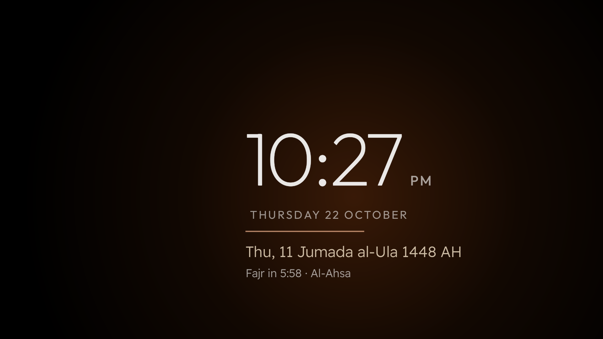

<div align="center">

# HomeLab Launcher · هوم لاب لانشر

**An Arabic-first, privacy-friendly home screen for Google TV, with prayer times, the Hijri date and your football leagues.**

**شاشة رئيسية عربية لأجهزة Google TV: مواقيت الصلاة، التاريخ الهجري، الطقس، ومباريات دوريك، بدون إعلانات.**

[](https://github.com/techdev-lab/homelab-launcher/actions/workflows/ci.yml)
[](LICENSE)


### [English](#english) · [العربية](#العربية)

[Install](docs/INSTALL.md) · [Configuration](docs/CONFIG.md) · [Security](SECURITY.md) · [Contributing](CONTRIBUTING.md)

<div dir="rtl">

[التثبيت](docs/INSTALL.md) · [الإعدادات](docs/CONFIG.md) · [الأمان](SECURITY.md) · [المساهمة](CONTRIBUTING.md)

</div>


</div>

---

## English

Built and tested on a Chromecast with Google TV 4K (Android 14). No root. No account. Fully reversible.

[How it was built](docs/JOURNEY.md) · [Use it with an AI assistant](docs/AI_ASSISTANT_PROMPTS.md)

### Why

The stock Google TV home screen is a wall of ads and recommendations, it speaks English to an Arabic household, and it knows nothing about prayer times or the leagues people here actually follow. HomeLab Launcher replaces it with a calm, glass-style home screen that shows **what matters at a glance** and gets out of the way: your apps, the next prayer, the weather, and the next match of your league.

It is written for Muslim and Arabic-speaking households first, but it is not tied to one country: you choose the city for prayer times and the leagues for the football cards.

### What you get

| | |
|---|---|
| **Arabic and English, end to end** | Follows the TV's language, or its own (`language` in the config, or Android's per-app language). In Arabic the whole screen is Arabic, right to left, including app names, league names and 114 team names, and the screensaver follows the same language. In English it is fully English. |
| **Prayer times, offline** | Umm al-Qura method, computed on the TV from the coordinates you set. No network and no location lookup: the city is typed into the config. Checked against an independent source to within 2 minutes. |
| **Hijri date** | Umm al-Qura calendar from the platform's ICU, next to the Gregorian date. |
| **Football cards** | One card per league group, side by side, e.g. the Saudi Pro League and "the big European leagues". A live match first, otherwise the next kick-off within 7 days. |
| **Favourite clubs** | Pick up to 10 clubs with the remote (Al Hilal, Al Nassr, Man City...). One card shows each club's live or next match in any competition, league, cup or continental, and moves to the next club every 5 seconds. |
| **Weather** | Current conditions for the same city (Open-Meteo, free, no key). |
| **Your dock** | Four apps of your choice on top (YouTube, Netflix, Shahid, Jellyfin, an IPTV player, anything), the rest in a grid. |
| **Remote buttons** | The YouTube button on the Chromecast remote keeps working after the stock launcher is gone. |
| **Screensaver** | A thin clock that glides around the screen with the Hijri date, the next prayer and a slow colour glow (no burn-in). |
| **VPN indicator** | Set your VPN app (e.g. WireGuard) and the Wi-Fi pill shows a green "VPN" capsule while the tunnel is up, red when it dropped. |
| **Two builds** | `online` (football, weather) and `offline` (no INTERNET permission at all). |
| **Small and private** | About 500 KB, fonts included. No analytics, no accounts, no ads. The offline build cannot reach the network. |

| English | App grid | Screensaver |
|---|---|---|
|  |  |  |

### Quick start

You need a Windows, macOS or Linux computer on the same Wi-Fi as the TV, and about 30 minutes.

1. **Read [docs/INSTALL.md](docs/INSTALL.md) once, end to end.** It has the exact order and the one trap that can put the TV in a boot loop.
2. Install the official [Android platform-tools](https://developer.android.com/tools/releases/platform-tools) (adb).
3. On the TV: update the system, enable Developer options and **Wireless debugging**, then pair:
   ```bash
   adb pair <TV-IP>:<PAIR-PORT> <CODE>
   adb connect <TV-IP>:<PORT>
   ```
4. Build the APK (see [Build](#build); there is no prebuilt release yet) and install it as a normal app, the stock home stays:
   ```bash
   adb install tvhome-online.apk
   ```
5. Copy `config/config.example.json`, set your city and leagues ([docs/CONFIG.md](docs/CONFIG.md)), push it:
   ```bash
   adb push config.json /sdcard/Android/data/com.gathin.tvhome/files/config.json
   ```
6. Make it the Home screen with `scripts/Set-TvhomeAsHome.ps1` (dry run first). Then turn on the YouTube button and the screensaver. See [INSTALL.md](docs/INSTALL.md).

> [!WARNING]
> **Never disable the stock launcher (`launcherx`) while `setupwraith` is still enabled.** Google TV then falls back to its setup wizard as the Home screen and can loop on boot. The script does it in the safe order; if you do it by hand, follow [INSTALL.md](docs/INSTALL.md) exactly. Rescue, if it happens: [factory reset with the button on the back](docs/INSTALL.md#rescue).

### Build

JDK 17 and the Android SDK (platform 34, build-tools 34) are needed.

```bash
cd launcher
./gradlew testOnlineReleaseUnitTest assembleOnlineRelease   # football + weather
./gradlew assembleOfflineRelease                             # no network at all
```

The APKs land in `launcher/app/build/outputs/apk/<flavor>/release/`. They are signed with your local debug key, which is fine for sideloading.

### Repository layout

```
launcher/           Android app (Java), tests in app/src/test
config/             config.example.json and ready examples for a few cities
scripts/            PowerShell helpers: inventory, make-Home, one-shot kit, with a fake-TV test suite
wallpapers/         generated wallpapers: homelab/ (6) and general/ (10, for any TV), with their generators
docs/               install guide, config reference, design notes, the build story, AI prompts, screenshots
```

### Permissions and privacy

| Permission or component | Build | What it is for |
|---|---|---|
| `INTERNET` | online only | Football (ESPN public scoreboard), weather (Open-Meteo) and the RSS feeds you configure. HTTPS only, 8-second timeouts, a 768 KB response cap, redirects not followed. |
| `ACCESS_NETWORK_STATE`, `ACCESS_WIFI_STATE` | both | The Wi-Fi pill. |
| `ACCESS_FINE_LOCATION` | both | Android 10 and later only let an app read the Wi-Fi network name with it. No code in the app calls a location API; the city for prayer times and weather is typed into the config. |
| Accessibility services (`HomeKeyService`, `InputKeyService`) | both, opt-in | Make the remote's Home and Input buttons work after the stock launcher is disabled. They see key events only, not window content, and stay off until you enable them. |
| Screensaver (`ClockDream`) | both | A daydream you pick in Settings. |

No analytics, no accounts, no crash reporting, no remote configuration. The full list of what the app and the install do to the TV is in [SECURITY.md](SECURITY.md).

### Status and limits

- Tested on **Chromecast with Google TV 4K** (`sabrina`, Android 14). The HD model (`boreal`) should behave the same but was not tested. Other Android TV devices: the app runs, the Home switch steps differ.
- Prayer times use **Umm al-Qura** only. Countries with another official method (for example Egypt) may see a few minutes of difference. A `prayer_method` option is on the roadmap.
- Football data comes from ESPN's public scoreboard. It has the Saudi Pro League, the big European leagues, the AFC and CAF Champions Leagues and the Gulf Cup, but **not** most Arab domestic leagues (Egypt, UAE, Qatar, Morocco were checked). Contributions of another free source are welcome.
- Arabic team names cover the six leagues used here (114 teams). Unknown teams show in English. Adding a league is a JSON edit: see [CONTRIBUTING.md](CONTRIBUTING.md).

### Contributing and support

- **A bug?** Open an issue with the bug-report form. It asks for the app version, the build and the device, and reminds you to remove IP addresses and keys.
- **Want to help?** [CONTRIBUTING.md](CONTRIBUTING.md) lists what is most useful: Arabic team names for more leagues, a free football source for Arab domestic leagues, a `prayer_method` option, and testing on other devices.
- **A security problem?** Follow [SECURITY.md](SECURITY.md) instead of opening a public issue.

### Credits and license

HomeLab Launcher is a fork of the `tvhome` launcher from [Gathin23/cleanyourtv](https://github.com/Gathin23/cleanyourtv) (MIT), which is why the Android package is still `com.gathin.tvhome`. Fonts: Outfit and Readex Pro, both SIL Open Font License 1.1. Data: ESPN public scoreboard, Open-Meteo. Details in [NOTICE.md](NOTICE.md).

MIT License, see [LICENSE](LICENSE).

---

## العربية

<div dir="rtl">

جُرّبت على Chromecast with Google TV 4K (أندرويد 14). بدون روت، وبدون حساب، وكل خطوة لها رجوع.

[قصة المشروع](docs/JOURNEY.ar.md) · [أوامر جاهزة للذكاء الاصطناعي](docs/AI_ASSISTANT_PROMPTS.ar.md)

### ليش هذا المشروع؟

الشاشة الأصلية في Google TV مليانة إعلانات واقتراحات، وتكلم البيت العربي بالإنجليزي، وما تعرف شي عن الصلاة ولا عن الدوريات اللي نتابعها. هذا اللانشر يحل محلها بشاشة هادئة بتصميم زجاجي تعرض **المهم بنظرة وحدة**: تطبيقاتك، والصلاة الجاية، والطقس، ومباراة دوريك الجاية.

موجّه للبيوت المسلمة والعربية، لكنه مو مربوط بدولة: تختار مدينتك للصلاة، ودورياتك لبطاقات الكورة. المصري يحط دوري أبطال أفريقيا، والإماراتي دوري أبطال آسيا وكأس الخليج، والسعودي دوري روشن، وهكذا.

### وش فيه؟

| | |
|---|---|
| **عربي وإنجليزي بالكامل** | يتبع لغة التلفزيون، أو لغته الخاصة (مفتاح `language` في الإعدادات، أو لغة التطبيق في أندرويد). بالعربي الشاشة كلها عربي من اليمين لليسار، حتى أسماء التطبيقات (يوتيوب، شاهد، جيليفين…) والدوريات و114 فريقاً، وشاشة التوقف تتبع نفس اللغة. بالإنجليزي كلها إنجليزي. |
| **مواقيت الصلاة بدون إنترنت** | بطريقة أم القرى، تنحسب على الجهاز من إحداثيات مدينتك. بدون تحديد موقع: تكتب المدينة في الإعدادات. فرقها عن مصدر مستقل أقل من دقيقتين. |
| **التاريخ الهجري** | تقويم أم القرى، جنب الميلادي. |
| **بطاقات الكورة** | بطاقة لكل مجموعة دوريات جنب بعض، مثلاً: الدوري السعودي، والدوريات الأوروبية الكبرى. المباشر أولاً، وإلا أقرب مباراة خلال 7 أيام. |
| **أنديتك المفضلة** | تختار حتى 10 أندية بالريموت (الهلال، النصر، مانشستر سيتي…). بطاقة وحدة تعرض مباراة كل نادٍ المباشرة أو الجاية في أي بطولة: الدوري أو الكأس أو النخبة الآسيوية أو أبطال أوروبا، وتنتقل للنادي اللي بعده كل 5 ثواني. |
| **الطقس** | لنفس المدينة (Open-Meteo، مجاني وبدون مفتاح). |
| **شريط تطبيقاتك** | أربع تطبيقات تختارها فوق (يوتيوب، نتفليكس، شاهد، جيليفين، برنامج IPTV، أي شي)، والباقي تحت في شبكة. |
| **زر يوتيوب في الريموت** | يبقى شغّال بعد ما نوقف اللانشر الأصلي. |
| **شاشة توقف** | ساعة رفيعة تنساب على الشاشة، معها الهجري والصلاة الجاية ووهج يتغيّر لونه بهدوء (تحمي الشاشة من الحرق). |
| **علامة الـVPN** | لو حطيت تطبيق الـVPN (مثل WireGuard) في الإعدادات، يطلع جنب كلمة واي فاي **VPN بالأخضر** وقت ما يكون شغّال، وبالأحمر لو انقطع. |
| **نسختين** | `online` (كورة وطقس) و`offline` (بدون صلاحية إنترنت أبداً). |
| **خفيف وخاص** | حوالي 500 كيلوبايت مع الخطوط. لا تتبع ولا حسابات ولا إعلانات. نسخة offline ما تقدر توصل للإنترنت أصلاً. |

| بالإنجليزي | شبكة التطبيقات | شاشة التوقف |
|---|---|---|
|  |  |  |

### البداية السريعة

تحتاج كمبيوتر (ويندوز أو ماك أو لينكس) على نفس الواي فاي حق التلفزيون، والريموت، وحوالي نص ساعة.

1. **اقرأ [دليل التثبيت](docs/INSTALL.md) مرة كاملة قبل ما تبدأ.** فيه الترتيب الصحيح، والفخ الوحيد اللي ممكن يدخل الجهاز في إعادة تشغيل متكررة.
2. **اكتب كلمة سر الواي فاي على ورقة.**
3. نزّل أداة [Android platform-tools](https://developer.android.com/tools/releases/platform-tools) الرسمية (فيها `adb`).
4. في التلفزيون: حدّث النظام، فعّل Developer options (اضغط 7 مرات على Android TV OS build في About)، وشغّل **Wireless debugging**، ثم:
   ```bash
   adb pair <TV-IP>:<PAIR-PORT> <CODE>
   adb connect <TV-IP>:<PORT>
   ```
5. ثبّت التطبيق كتطبيق عادي (الشاشة الأصلية تبقى). ما فيه إصدار جاهز للتنزيل بعد، فابنِ الملف أول من قسم «بناء التطبيق» تحت:
   ```bash
   adb install tvhome-online.apk
   ```
6. انسخ `config/config.example.json` أو ملف مدينة من مجلد `config/examples`، عدّل المدينة والدوريات والتطبيقات، وادفعه:
   ```bash
   adb push config.json /sdcard/Android/data/com.gathin.tvhome/files/config.json
   ```
7. خلّه الشاشة الرئيسية بالسكربت `scripts/Set-TvhomeAsHome.ps1` (يجرب أول بدون تغيير)، ثم فعّل زر يوتيوب وشاشة التوقف. التفاصيل في [دليل التثبيت](docs/INSTALL.md).

> ⚠️ **تحذير:**
> **لا توقف اللانشر الأصلي `launcherx` وحزمة `setupwraith` لسه شغّالة.** Google TV ساعتها يخلي معالج الإعداد هو الشاشة الرئيسية، والجهاز ممكن يعلق في إعادة تشغيل. السكربت يسويها بالترتيب الصحيح. ولو صارت، الحل: **اضغط مطوّلاً الزر اللي ورا الكروم كاست لين اللمبة تصير صفراء ثم بيضاء** (factory reset). كل التفاصيل في [قسم الإنقاذ](docs/INSTALL.md#rescue).

### أسماء الدوريات اللي تشتغل

`ksa.1` دوري روشن · `ksa.kings.cup` كأس الملك · `afc.champions` أبطال آسيا · `caf.champions` أبطال أفريقيا · `caf.confed` الكونفدرالية · `global.gulf_cup` كأس الخليج · `uefa.champions` أبطال أوروبا · `eng.1` الإنجليزي · `esp.1` الإسباني · `ita.1` الإيطالي · `ger.1` الألماني · `fra.1` الفرنسي · `fifa.worldq.afc` و`fifa.worldq.caf` تصفيات كأس العالم.

**صراحة:** مصدر البيانات (ESPN) ما فيه الدوري المصري ولا الإماراتي ولا القطري ولا المغربي (جربناها كلها). لو تعرف مصدر مجاني ثاني، ساهم معنا.

### مواقيت الصلاة

الحساب بطريقة **أم القرى** فقط حالياً. في الدول اللي عندها طريقة رسمية ثانية (مثل مصر) ممكن يطلع فرق دقائق. خيار `prayer_method` في خطة التطوير.

### الصلاحيات والخصوصية

| الصلاحية أو المكوّن | النسخة | وش تسوي |
|---|---|---|
| `INTERNET` | online فقط | الكورة (مصدر ESPN العام) والطقس (Open-Meteo) وخلاصات RSS اللي تضبطها. HTTPS فقط، مهلة 8 ثواني، حد 768 كيلوبايت للرد، وما تُتبع التحويلات. |
| `ACCESS_NETWORK_STATE` و`ACCESS_WIFI_STATE` | النسختين | شريحة الواي فاي. |
| `ACCESS_FINE_LOCATION` | النسختين | أندرويد 10 وما فوق ما يخلي التطبيق يقرأ اسم شبكة الواي فاي إلا بها. التطبيق ما يستدعي أي واجهة موقع؛ المدينة تكتبها في الإعدادات. |
| خدمات إمكانية الوصول (`HomeKeyService` و`InputKeyService`) | النسختين، اختيارية | تشغّل زرّي Home وInput في الريموت بعد إيقاف اللانشر الأصلي. ترى ضغطات الأزرار فقط، مو محتوى الشاشة، وتبقى مطفية لين تفعّلها. |
| شاشة التوقف (`ClockDream`) | النسختين | تختارها من الإعدادات. |

بدون تتبع ولا حسابات ولا تقارير أعطال ولا إعدادات عن بُعد. كل التفاصيل في [SECURITY.md](SECURITY.md).

### بناء التطبيق

ما فيه إصدار جاهز للتنزيل بعد، فتبنيه بنفسك. تحتاج JDK 17 وAndroid SDK (المنصة 34):

```bash
cd launcher
./gradlew testOnlineReleaseUnitTest assembleOnlineRelease
```

### المساهمة والدعم

- **مشكلة؟** افتح بلاغاً من نموذج «Bug report». يسألك عن إصدار التطبيق والنسخة والجهاز، ويذكّرك تشيل عناوين IP والمفاتيح.
- **تبي تساهم؟** [CONTRIBUTING.md](CONTRIBUTING.md) فيه أنفع المساهمات: أسماء فرق عربية لدوريات أكثر، ومصدر كورة مجاني للدوريات العربية، وخيار `prayer_method`، والتجربة على أجهزة ثانية.
- **ثغرة أمنية؟** اتبع [SECURITY.md](SECURITY.md) وما تفتح بلاغاً عاماً.

### الشكر والرخصة

المشروع مبني على لانشر `tvhome` من مشروع [Gathin23/cleanyourtv](https://github.com/Gathin23/cleanyourtv) (رخصة MIT)، ولهذا اسم الحزمة `com.gathin.tvhome`. الخطوط: Outfit وReadex Pro (رخصة SIL OFL 1.1). البيانات: ESPN وOpen-Meteo. التفاصيل في [NOTICE.md](NOTICE.md).

رخصة MIT، شوف [LICENSE](LICENSE).

</div>
