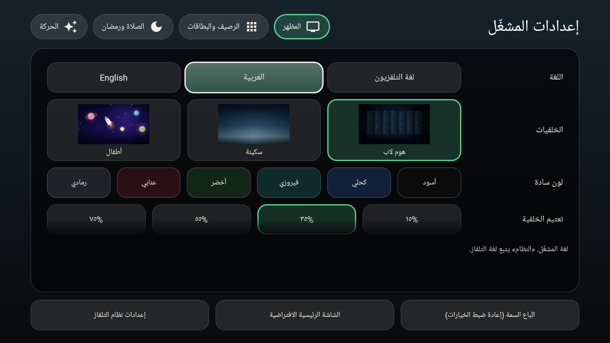
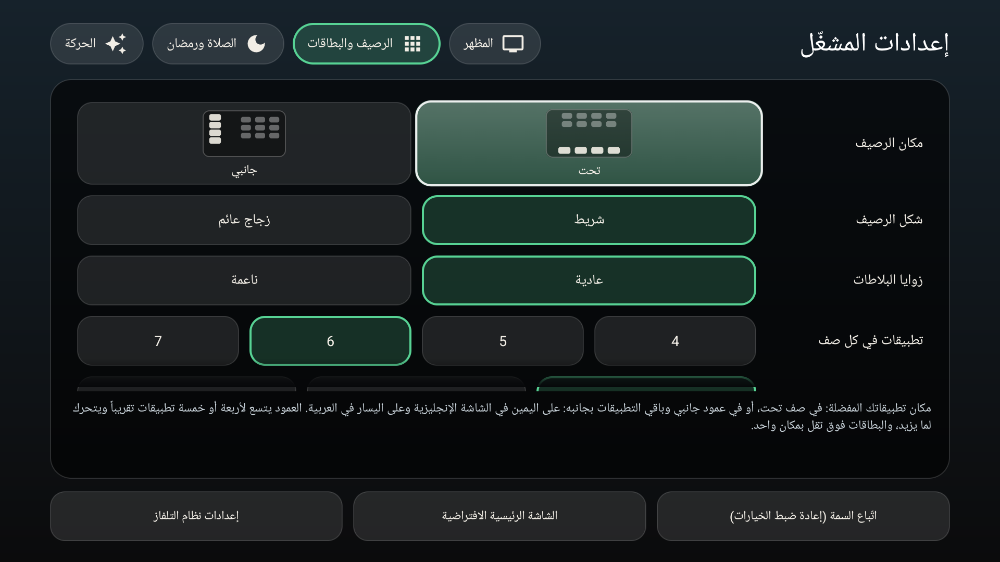
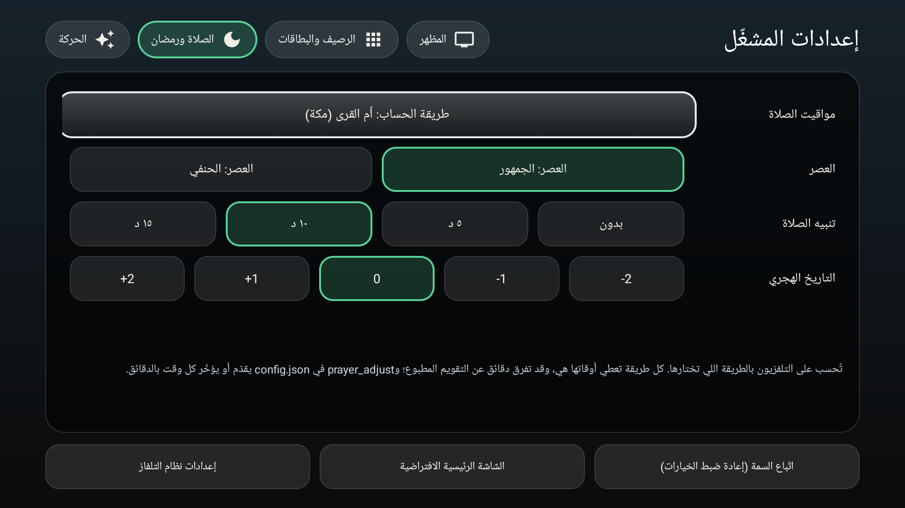
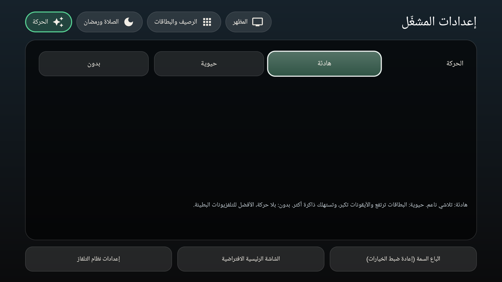
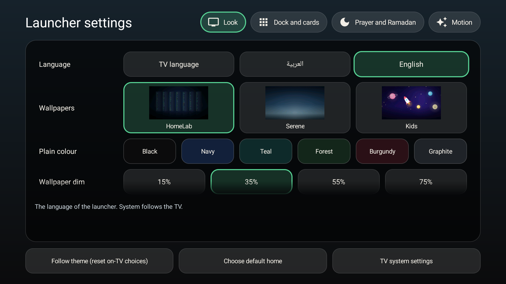
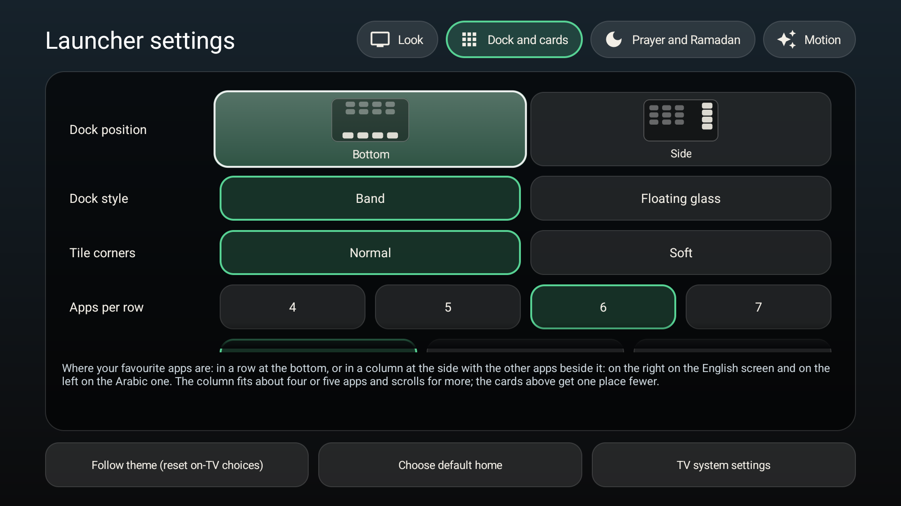
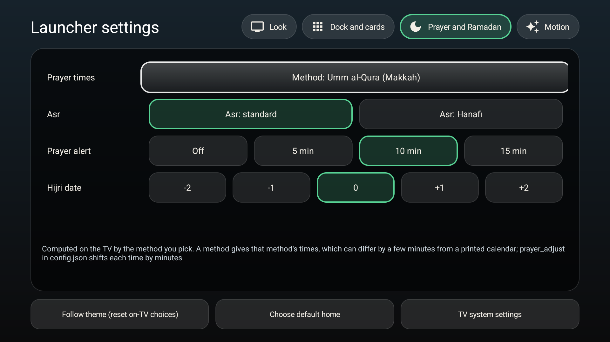
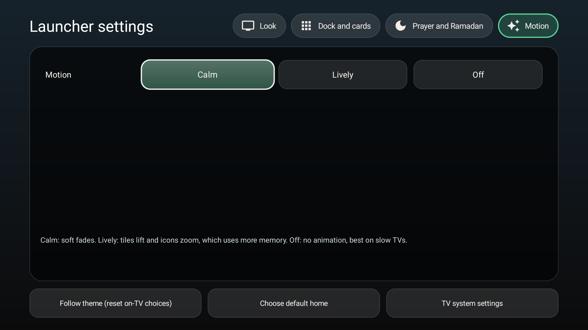

# الإعدادات الزجاجية: ملاحظة تصميم

[English](SETTINGS_GLASS.md) · العربية

الحالة: **المرحلة الأولى، نُفّذت** (كُتبت قبل الكود؛ وجُرّبت على Chromecast 4K في التركيبات الثماني تحت بالريموت فقط). شاشة إعدادات المشغّل كانت تبدو وكأنها من تطبيق ثاني: قائمة داكنة مسطحة من 14 صف وأزرار رمادية، والشاشة الرئيسية زجاجية. هذي الملاحظة تعيد تصميم الشاشة فقط. ما في خيار جديد ولا صلاحية جديدة ولا مفتاح جديد في `config.json` ولا شي جديد يتحفظ في اختيارات التلفزيون: كل زر يكتب بالضبط اللي يكتبه اليوم.

المرحلة الثانية (معاينة حية للشاشة الرئيسية جنب الإعدادات) خارج هذا العمل وتحتاج موافقة جديدة.

## كيف الشاشة اليوم

عمود طويل واحد: عنوان، ثم كل صف له عنوان أبيض وتحته أزرار رمادية وتحتها فقرة شرح. الألوان والخلفيات ومكان الرصيف كلها أزرار نص، فالمشاهد ما يشوف أثر الاختيار قبل ما يضغط. والمركّز عليه والمختار لونان رماديان مسطحان وأخضر باهت.

## التصميم

### 1. أربع بطاقات أقسام

| القسم | الصفوف |
|---|---|
| المظهر | اللغة، الخلفيات (ثلاث مجموعات)، اللون السادة، تعتيم الخلفية، الأرقام، شكل الساعة |
| الرصيف والبطاقات | مكان الرصيف، شكل الرصيف، زوايا البلاطات، عدد التطبيقات في الصف، حجم النص، بطاقات الشاشة الرئيسية، الأندية المفضلة (نسخة الإنترنت فقط)، التطبيقات المخفية |
| الصلاة ورمضان | طريقة الصلاة، العصر، تنبيه الصلاة، التاريخ الهجري |
| الحركة | الحركة |

الأزرار الثلاثة اللي ليست تفضيلات (استخدام تخطيط الثيم، التطبيق الرئيسي الافتراضي، إعدادات التلفزيون) تبقى في صف سفلي تحت البطاقة، وتوصلها من أي قسم بزر الأسفل. وهي مو قسم خامس.

بطاقة واحدة فقط على الشاشة في كل مرة، بنفس زجاج بطاقات الشاشة الرئيسية (زجاج داكن وحافة رفيعة وزوايا 20dp). فوقها شريط من عناوين الأقسام الأربعة، لكل عنوان أيقونة صغيرة، ويأخذ الشريط التركيز أيضاً، فالقسم على بعد ضغطة أو ضغطتين.

### 2. نُري ما يسويه الاختيار

- **الخلفيات**: كل مجموعة تعرض مصغّرة لأول صورة فيها، من الـAPK نفسه. المسودة الأولى كانت تصغّر الصور وقت البناء في ملفات جديدة؛ لكن فك ضغط الملف الموجود بربع حجمه (`inSampleSize`، حوالي 240 × 135 بكسل، ثلاث صور، في خيط خلفي) يزيد **صفر بايت** على الـAPK، وهذا هو المقصود بحد المجلس (150 كيلوبايت). وإذا تعذّرت قراءة المصغّرة يرجع الزر زر النص العادي كما هو اليوم.
- **الألوان السادة**: الزر هو اللون نفسه (هكذا اليوم)، ويأخذ شكل المختار والتركيز الجديد.
- **مكان الرصيف**: رسم صغير للشاشة والرصيف تحت، أو عمود في نهاية جهة القراءة. و**ينعكس بالعربي** (العمود على اليسار) مثل الشاشة الحقيقية. والرسم تحسمه دالة نقية، فاختبار يتأكد من الانعكاس.
- **الأرقام**: الزر يعرض عيّنة، `123` والأرقام الهندية المقابلة لها.

### 3. المختار والمركّز عليه

- **المختار**: قاعدة مملوءة بالأخضر المميِّز بشفافية خفيفة مع حافة مميِّزة 2dp (أخضر اليوم نفسه، لا لون جديد).
- **المركّز عليه**: الحلقة الزجاجية نفسها اللي في تظليل الشاشة الرئيسية: تعبئة لامعة خفيفة وحافة بيضاء ساطعة 2dp.
- الزر اللي هو مختار ومركّز عليه يعرض الحلقة فوق القاعدة الخضراء، فيبقى المختار ظاهراً وأنت تمر عليه.
- أزرار الألوان تحتفظ بلونها في الحالتين.

### 4. سطر شرح واحد

اختفت فقرة الشرح تحت كل صف. أسفل البطاقة سطر واحد (سطران عند الحاجة) يعرض شرح الصف اللي عليه التركيز ويتغير مع حركة التركيز. النصوص هي شروحات اليوم؛ واللغة وعدد التطبيقات في الصف، وما كان لهما شرح، ياخذان شرحاً قصيراً.

## التنقل

جافا نقية بلا أي نوع من أندرويد، في `SettingsNav`، وتُختبر على JVM مثل `SideNav` و`GridNavigation`.

الشاشة مجموعة **مناطق**: شريط الأقسام، وصفوف القسم الظاهر، والصف السفلي. والموضع هو `(القسم، الصف، الزر)`؛ والأزرار مرقّمة بـ**ترتيب القراءة**، فالزر الأول على اليمين في الشاشة العربية ويتبدّل اليمين واليسار (`rtl`) كما في بقية المشغّل.

| الزر | القاعدة |
|---|---|
| أعلى | من صف إلى الصف فوقه (يبقى رقم الزر أو يُقصّ على الصف الأقصر). الصف الأول يروح إلى تبويب قسمه في الشريط. التبويب يبقى. والصف السفلي يروح إلى آخر صف في القسم الظاهر (أو التبويب إن ما فيه صفوف). |
| أسفل | التبويب يروح إلى أول زر في أول صف (أو إلى الصف السفلي إن ما في القسم صفوف). الصف يروح إلى الصف تحته؛ وآخر صف يروح إلى الصف السفلي. والصف السفلي يبقى. |
| باتجاه النهاية (يمين في الإنجليزية، يسار في العربية) | الزر التالي. عند آخر زر في الصف: القسم التالي، نفس رقم الصف (مقصوص)، أول زر. في آخر قسم: يبقى. في الشريط: التبويب التالي. في الصف السفلي: الزر التالي ويبقى عند الأخير. |
| باتجاه البداية | الصورة المعكوسة: الزر السابق؛ عند الأول، آخر زر في القسم السابق؛ ويبقى في القسم الأول. |

قواعد الأمان، ولكل واحدة اختبار يفشل بدونها:

- **لا التفاف ولا قفز.** الحافة تبقي التركيز مكانه؛ لا يلتف ولا يهبط على عنصر بعيد.
- **الصف بزر واحد** يعبر إلى القسم التالي في الاتجاهين معاً (هو الأول والأخير).
- **القسم بلا صفوف** (قد يفرغ بسبب نسخة أو تغيير مستقبلي) يُدخل عند تبويبه ويُعبَر، ولا يصير طريقاً مسدوداً.
- **العربي**: المواضع نفسها مع تبديل الزرين الأفقيين.
- **موضع خارج النموذج** (موضع قديم بعد تغير قسم) يُقصّ إلى موضع حقيقي، لا استثناء، فيمكن دايماً إيجاد التركيز من جديد.
- **كل موضع يوصل الشريط والصف السفلي بضغطات أعلى وأسفل فقط**، والشريط يوصل كل قسم بزر أفقي لكل قسم. واختبار يمشي على كل المواضع ويتأكد، كما يفعل `SideNavTest` للرصيف.

يعطي الـActivity النموذجَ الأزرار الظاهرة فعلاً (النسخة بلا إنترنت ما فيها أندية ولا بطاقات طقس وكرة) ويحرّك التركيز بنفسه. وإذا ما كان للنموذج عنصر لموضع ما، يمرّ الزر إلى بحث التركيز الأصلي في أندرويد، فالسلوك القديم هو الاحتياط ولا تنقفل الشاشة. زر الرجوع ما نلمسه: يغلق الشاشة والرئيسية تحتها. والأزرار اللي تفتح نوافذ وشاشات (طريقة الصلاة، الأندية، التطبيقات المخفية، تحذير الحركة النشطة) تتصرف كاليوم، ويرجع التركيز للزر اللي فتحها.

## ما لا يتغير

- كل زر يحفظ نفس المفتاح بنفس القيمة كاليوم؛ ولا شي جديد في `config.json` ولا اختيارات التلفزيون.
- لا صلاحية، لا طلب شبكة، لا خط جديد، لا مكتبة جديدة، لا ملف صورة جديد.
- `chip()` و`fill()` يحملان منطق الانعكاس في الصفوف القديمة؛ والكود الجديد يحافظ على قاعدتهما (الأزرار تُضاف بترتيب القراءة وتنعكس في الشاشتين العربية والعبرية)، والاختبارات تغطيها عبر نموذج التنقل.
- يبقى الإصدار 3.0.0 في هذا التغيير.

## النصوص

الجديد: عناوين الأقسام الأربعة والشرحان الناقصان، في `values` و`values-ar` (و`ResourcesTest` يفشل أصلاً إن غاب العربي). الشروح القديمة تُستعمل كما هي. اللغات الباقية ترجع للإنجليزية كالمعتاد.

## الأقسام الأربعة على التلفزيون

اللقطات من Chromecast with Google TV 4K بمدينة العرض (الرياض) وبالريموت فقط، والتركيز في كل لقطة على أول زر في القسم.

| المظهر | الرصيف والبطاقات |
|---|---|
|  |  |
| **الصلاة ورمضان** | **الحركة** |
|  |  |

والأربعة نفسها على الشاشة الإنجليزية:

| المظهر | الرصيف والبطاقات |
|---|---|
|  |  |
| **الصلاة ورمضان** | **الحركة** |
|  |  |

## الشروط (من المجلس، 2026-10-31)

1. هذي الملاحظة أولاً، بالإنجليزية مع نسخة عربية.
2. التنقل صنف نقي، وكل قاعدة لها اختبار فشل (حدود الأقسام، الترتيب العربي، الصف بزر واحد).
3. ثماني تركيبات على Chromecast 4K بالريموت فقط: إنجليزي وعربي، الرصيف تحت وعلى الجنب، نص البطاقات صغير وكبير؛ وزر الرجوع يرجع للرئيسية. إذا فشلت واحدة لا يُدمج التصميم.
4. لا مرحلة لاحقة بدون موافقة جديدة.

## خطة الاختبار

على JVM، تُكتب أولاً وتُعرض وهي تفشل: `SettingsNavTest` (كل قاعدة فوق)، و`DockSketchTest` (تحت وجنب، منعكس بالعربي، الخلايا داخل الإطار وبلا تداخل)، والنصوص الجديدة في `ResourcesTest`. ثم lint والنسختان. وعلى التلفزيون: التركيبات الثمان بالريموت فقط، وإن كل زر ما زال يحفظ ما كان يحفظه.

